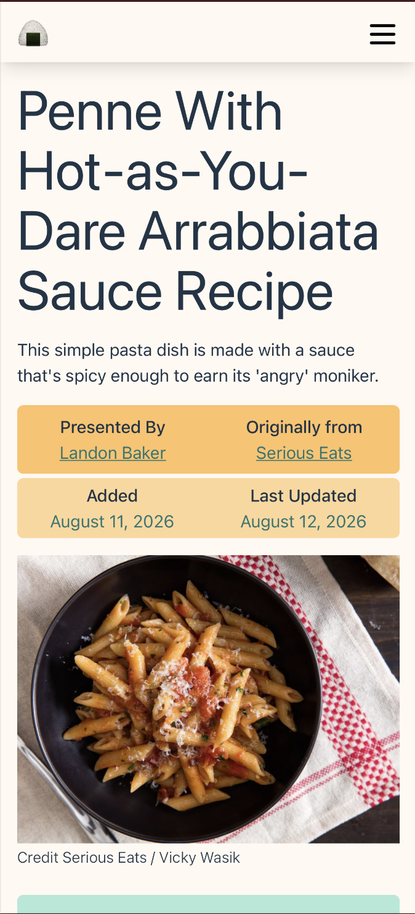

# Recipe Manager

A (in-progess!!) self-hosted recipe-sharing and collabrative cooking platform for friends.

 - A central destination to save recipe across any source (website, book, etc).
 - A shared collection of recipes between close-friends and family.
 - *Community Edits* on recipes to share tweaks and tips.
 - Self-hosted, human-made, and free

## What's in this repo?
This repo holds only the frontend, see the service, database, and documentation repos for the complete platform.

## First Time Setup

1. [Install NodeJs](https://nodejs.org/en/download). This will include npm.
2. In this project's root directory, run `npm i` to install the dependencies.
    - This project's dependencies are shown in package.json, as well as the project's scripts.

## Run Development Server

1. In this project's root directory, run `npm run dev` to activate frontend development server.
   1. The python backend is currently not needed for the frontend to work.